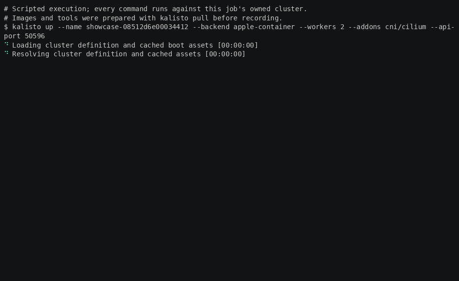
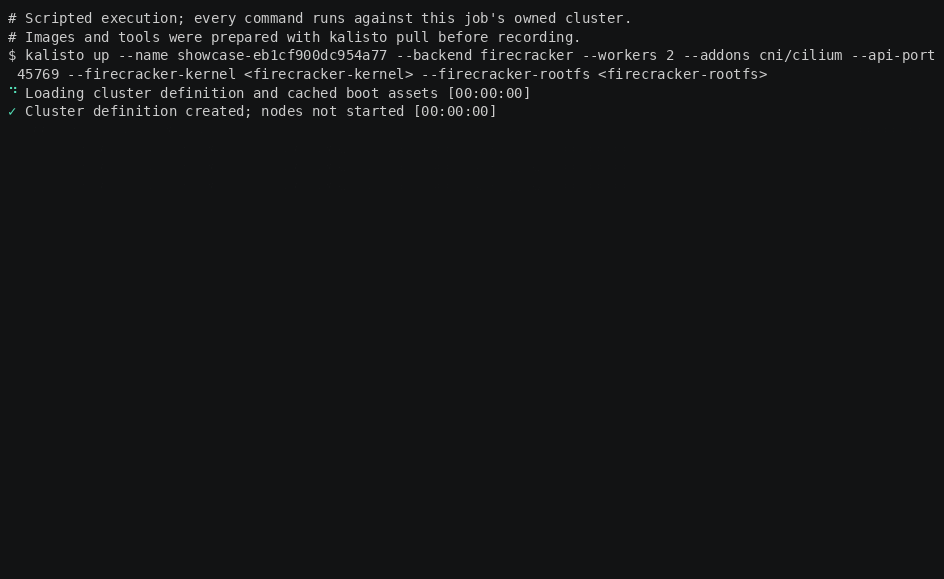
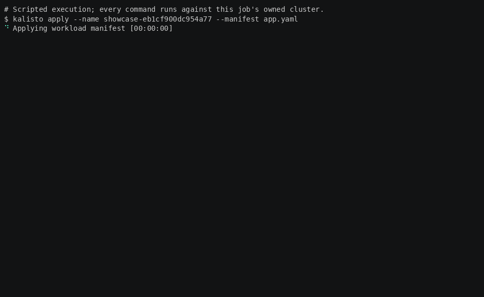
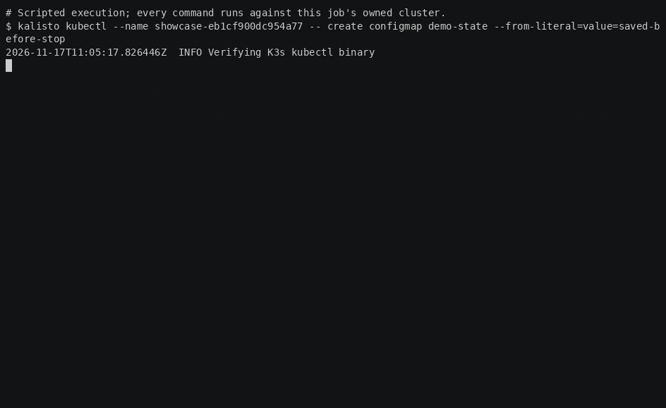
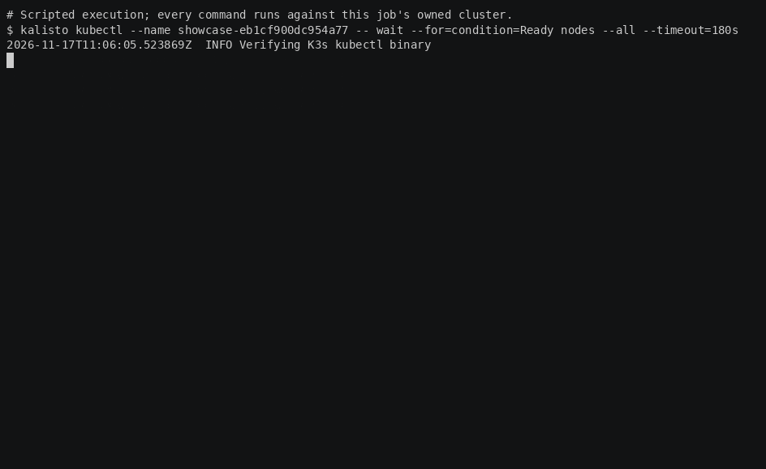

<p align="center">
  
</p>

# Kalisto

Local Kubernetes with k3s: Apple containers by default on macOS, optional Lima,
and Firecracker on Linux.

## Demos

### macOS · Apple containers

#### Fresh three-node Cilium startup

[](https://asciinema.org/a/9NiazaB8VfoFCw3k)

#### Deploy an HTTP application

[](https://asciinema.org/a/0INmR0OqGcLGeNjq)

#### Stop and resume with persisted state

[](https://asciinema.org/a/eUJ9iZO0kTBWH8BD)

#### Add a worker and spread replicas

[](https://asciinema.org/a/VstCRHViyYAFGEBr)

### Linux · Firecracker

#### Fresh three-node Cilium startup

[](https://asciinema.org/a/60uyxYoIpzIXhliw)

#### Deploy an HTTP application

[](https://asciinema.org/a/AWGgMs2Jo7h0DQxf)

#### Stop and resume with persisted state

[](https://asciinema.org/a/YmlRAv2BCcgNcDcx)

#### Add a worker and spread replicas

[](https://asciinema.org/a/nZWS17frmHFgIEPm)

Recorded development revisions: Apple `93390c52e4f0` (macOS Apple silicon),
Firecracker `4fe2abc74675` (Linux x86_64). Preparation is outside startup recordings.

## Resize a cluster

```sh
kalisto scale --name dev --workers 3
kalisto scale --name dev --workers 1
```

The count excludes the control plane. Scale-down drains the highest-index
workers first, respecting disruption budgets and refusing forced eviction or
automatic deletion of `emptyDir` data. Removed workers' VM disks and local data
are permanently deleted; back up any data you need before shrinking.

If removal fails, resolve the reported problem and repeat the same command.
Completed removals remain persisted; an unfinished removal must be resumed
before scaling up.

## Documentation

The canonical guides and reference live at
**[cloudflavor.io/kalisto/docs](https://cloudflavor.io/kalisto/docs/)**.

- [Install and start a cluster](https://cloudflavor.io/kalisto/docs/getting-started/)
- Backends: [Apple containers](https://cloudflavor.io/kalisto/docs/apple-container/),
  [Lima](https://cloudflavor.io/kalisto/docs/lima/),
  [Firecracker](https://cloudflavor.io/kalisto/docs/firecracker/)
- [CLI and cluster lifecycle](https://cloudflavor.io/kalisto/docs/cli/)
- [Workloads, add-ons and ingress](https://cloudflavor.io/kalisto/docs/workloads/)
- [Backup and restore](https://cloudflavor.io/kalisto/docs/archives/)
- [AI agents and MCP](https://cloudflavor.io/kalisto/docs/agents/)
- [Contributor and artifact tooling](https://cloudflavor.io/kalisto/docs/development/)

## Downloads

[Download Kalisto from GitHub Releases](https://github.com/cloudflavor/kalisto/releases)
and verify the accompanying `SHA256SUMS`. Packages target macOS ARM64, Linux
ARM64 and Linux x86_64 only. Read the platform prerequisites before preparing or
starting a cluster; prereleases are not stable releases. Product releases do not
require a website update.

## Source

[GitHub](https://github.com/cloudflavor/kalisto)
